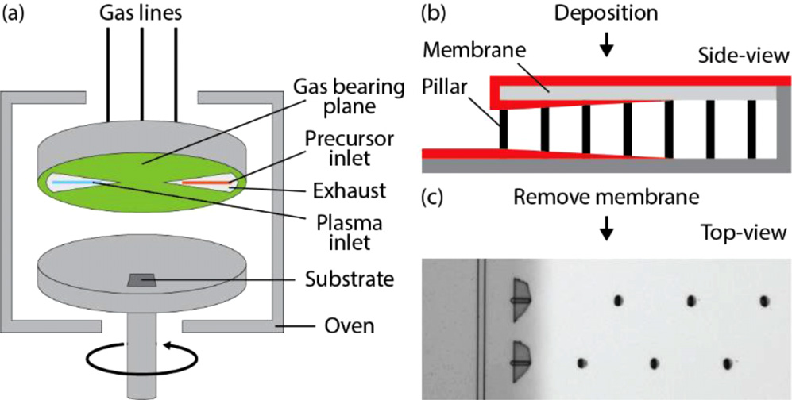
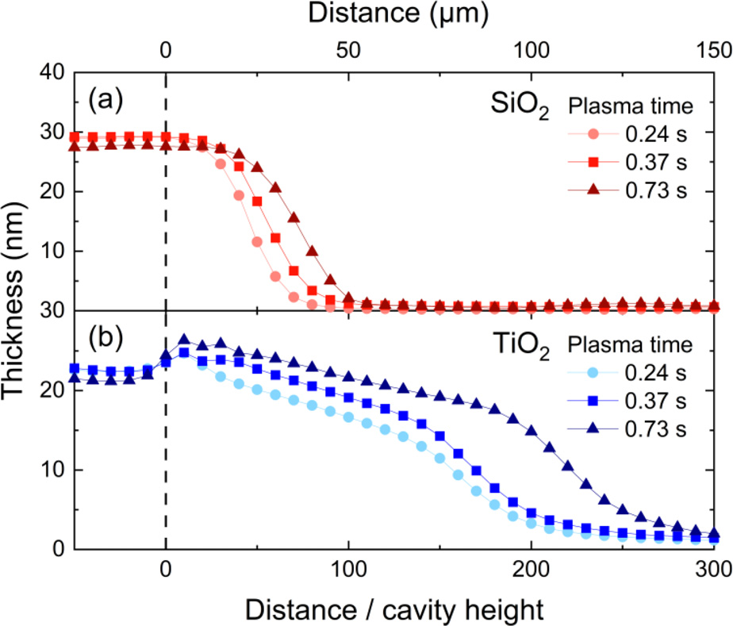

# Atomic layer deposition

원자층 증착(atomic layer deposition, ALD)에서는 기판 표면을 서로 다른 반응물에 차례로 노출한다. 첫 반응물이 접근할 수 있는 자리를 소모하면 표면 반응이 포화되고, 다음 반응물이 표면에 새로운 반응 자리를 만든다. 이 순서를 반복하면 사이클 수로 막 두께를 조절할 수 있다. 열 ALD와 플라즈마 강화 ALD(plasma-enhanced atomic layer deposition, PEALD)는 이 원리를 공유한다. 두 방법의 차이는 다음 반응을 일으키는 화학종과 그 화학종이 기판까지 도달하는 방식에 있다.[1,2,3,4,5]

다른 증착법과의 비교는 [Thin-film deposition](thin-film-deposition.md)에서 다룬다.

## 1. 자기 제한 반응과 열 ALD

### (1) 한 사이클의 표면 변화

시간 분할 ALD의 한 사이클은 **전구체 주입 → 퍼지 → 공반응물 주입 → 퍼지**로 이루어진다. 전구체는 막에 들어갈 원소를 공급하고, 공반응물은 표면에 결합한 전구체의 리간드와 반응하여 다음 사이클이 시작될 수 있게 한다. 퍼지(purge)에서는 불활성 기체를 흘리거나 배기하여 남은 기체 반응물과 휘발성 부산물을 제거한다. 두 반응물이 기체 상태에서 만나면 화학 기상 증착(chemical vapor deposition, CVD)에 해당하는 성장분이 섞일 수 있다.[1,2,3]

한 사이클에서 자라는 두께는 반응할 수 있는 자리의 수와 흡착한 분자가 차지하는 면적에 따라 달라진다. 부피가 큰 리간드는 이웃 자리로 접근하는 분자를 가로막을 수 있다. 따라서 반응이 포화된 표면에도 기하학적으로 빈 공간이 남을 수 있고, 한 사이클의 성장은 원자 한 층의 두께보다 작을 수 있다.[1,2,4]

### (2) 산화알루미늄의 두 반쪽 반응

산화알루미늄($\mathrm{Al_2O_3}$)의 열 ALD에서는 trimethylaluminum (TMA, $\mathrm{Al(CH_3)_3}$)과 물을 교대로 공급한다. 수산기($\mathrm{-OH}$)가 있는 표면에서 TMA의 메틸기 하나가 수소를 받아 메테인($\mathrm{CH_4}$)으로 떨어져 나가면, Al은 표면 산소에 결합한다. 이어서 물을 넣으면 표면에 남은 Al–메틸 결합이 물과 반응하여 다시 메테인이 나오고, 다음 TMA와 반응할 수 있는 Al–OH가 생긴다.[3,4]

아래 식은 **결합 하나의 교환**을 나타낸다. $\mathrm{S}$는 기존 표면 골격, $\mathrm{Me}$는 메틸기($\mathrm{CH_3}$)이다. 둘째 줄의 $\mathrm{S'}$는 메틸기 하나를 제외한 나머지 표면 결합을 묶은 표기이다.[3,4]

$$
\begin{aligned}
\mathrm{S{-}OH + AlMe_3} &\longrightarrow \mathrm{S{-}O{-}AlMe_2 + CH_4},\\
\mathrm{S'{-}Al{-}Me + H_2O} &\longrightarrow \mathrm{S'{-}Al{-}OH + CH_4}.
\end{aligned}
$$

첫 식은 TMA가 한 수산기와 반응한 경우이다. 실제로는 같은 분자가 이웃 수산기와도 반응할 수 있어 Al 하나에 남는 메틸기 수가 달라진다. 이 두 식만으로 한 사이클에 쌓인 Al 원자 수나 막 두께를 정할 수 없는 이유이다.[3,4]

## 2. 플라즈마 강화 ALD의 반응종과 반응기

### (1) 산소 플라즈마와 리간드 제거

TMA 다음에 물 대신 산소 플라즈마를 공급하면 산소 라디칼 등 반응성이 높은 화학종이 표면의 메틸기를 산화한다. 열 공정에서 물을 공급했을 때는 메테인이 나오는 반면, 산소 플라즈마 단계의 배기가스에서는 이산화탄소와 물도 검출된다. 이렇게 생긴 물은 남아 있는 메틸기와 다시 반응하여 메테인을 만들 수 있다. 따라서 플라즈마 단계에서 메테인을 검출해도 리간드가 모두 하나의 경로로 제거되었다고 해석할 수는 없다.[4,5]

산소 플라즈마는 낮은 기판 온도에서도 리간드 제거를 촉진할 수 있다. 다만 온도를 낮췄을 때 두께 증가량만 보면 얼마나 많은 Al이 막에 들어갔는지 오판할 수 있다. 산화알루미늄 실험에서는 온도에 따라 막의 밀도와 수소 함량도 변했다. 열 공정과 PEALD를 비교할 때는 사이클당 두께와 함께 단위 면적에 쌓인 Al 원자 수, 막 밀도 또는 잔류 수소를 비교해야 한다.[3,5,6]

### (2) 직접형과 원격형 플라즈마

직접형(direct plasma)에서는 기판이 방전 영역에 놓인다. 원격형(remote plasma)에서는 기판에서 떨어진 곳에서 방전을 일으킨 뒤 활성종을 기판으로 보낸다. 두 구성을 구분하는 이유는 중성 라디칼의 화학반응과 에너지를 가진 이온의 충돌이 막에 서로 다른 영향을 줄 수 있기 때문이다. 원격형에서도 장치 구조와 압력에 따라 이온이 기판까지 도달한다. 따라서 ‘원격형’이라는 명칭만으로 이온 노출을 배제할 수 없다.[7,8]

예를 들어 산소 플라즈마로 산화아연을 증착한 실험에서는 직접형과 원격형 사이에 막 조성과 결정성 차이가 나타났고, 직접형에 노출된 고분자 기판에서는 표면 형태의 변화가 관찰되었다. 원격형 산소 플라즈마를 사용한 별도 실험에서는 기판 위치의 이온 에너지와 플럭스를 측정하고, 플라즈마가 방출하는 진공 자외선이 산화막 구조의 전기적 특성에도 영향을 줄 수 있음을 보였다. 열에 민감한 기판의 공정 조건을 정할 때에는 증착 온도와 함께 기판 자체가 플라즈마 노출 후 어떻게 변했는지 확인할 필요가 있다.[7,8]

### (3) 공반응물 선택과 질화물 성장

플라즈마 기체는 어떤 원소가 막에 들어가는지도 결정한다. 같은 Al 전구체인 TMA를 쓰더라도 산소 플라즈마를 쓰면 산화알루미늄을, 암모니아($\mathrm{NH_3}$) 플라즈마를 질소원으로 쓰면 질화알루미늄($\mathrm{AlN}$)을 성장시킬 수 있다. 질화 공정을 설계할 때는 TMA 노출량과 암모니아 플라즈마 노출 시간을 각각 바꾸어 포화를 다시 확인한다. 산화 공정에서 얻은 포화 시간을 질화 공정에 그대로 적용할 근거는 없다.[4,9,10]

## 3. 공정 조건과 성장량의 판독

### (1) 노출량과 퍼지 시간

분자 반응물의 노출량은 표면 부근 반응물의 분압 $p_A(t)$를 주입 구간에서 시간 $t$에 대해 적분한 값이다. 단위는 $\mathrm{Pa\,s}$이며, 분압이 거의 일정할 때에는 분압과 노출 시간의 곱으로 근사한다. 밸브를 여는 시간이 같아도 분압이 다르면 노출량이 달라진다. PEALD에서 산소 공급 분압은 여러 화학종 가운데 산소 라디칼이 얼마나 많이 기판에 도달했는지를 직접 알려주지 않으므로 플라즈마 출력, 압력, 노출 시간을 함께 기록한다.[1,2,7,8]

!!! info "[Measurement]"
    사이클 수와 온도를 고정하고, 한쪽 반응물의 노출만 늘리면서 두께를 측정한다. 다른 반쪽 반응도 같은 방법으로 확인한다. 두 곡선에서 두께가 각각 더 증가하지 않는 구간을 찾은 다음, 각 퍼지 시간만 따로 늘려 본다. 예를 들어 저온 TMA–물 공정에서 물이 충분히 제거되지 않으면 다음 TMA 주입 때 추가 성장이 일어날 수 있다. 퍼지를 늘렸을 때 두께가 줄어드는지 확인하면 반응물 중첩이 원인일 가능성을 점검할 수 있다.[1,3,4]

### (2) 증착 온도와 ALD window

흔히 기판 온도를 바꾸어도 사이클당 성장량(growth per cycle, GPC)이 거의 일정한 구간을 **ALD window**라고 부른다. 이 온도 곡선과 앞의 노출량 곡선은 다른 질문에 답한다. 특정 온도에서 노출을 늘려도 성장이 포화되지만, 온도를 바꾸면 반응 가능한 수산기 밀도가 바뀌어 포화 GPC 자체가 달라질 수 있다.[1,3,5,6]

낮은 온도에서 GPC가 감소한다면 정해진 주입 시간 동안 표면 반응이 충분히 진행됐는지 살펴본다. 반대로 쉽게 응축되는 전구체라면 낮은 온도에서 여러 층이 흡착되어 GPC가 커질 수도 있다. 높은 온도에서는 전구체의 탈착이 성장량을 줄이거나 열분해가 추가 성장을 일으킬 수 있다. 온도 곡선의 기울기만으로 원인을 정하기 어려우므로 각 온도에서 노출량과 퍼지 시간에 대한 의존성을 함께 본다.[1,2,3]

### (3) 초기 핵생성과 정상 성장

첫 사이클의 전구체는 기판과 반응하고, 막이 기판을 덮은 뒤에는 이미 성장한 막의 표면과 반응한다. 예를 들어 TMA–물 공정에서 수소로 종결된 Si 표면은 산화된 Si 표면보다 초기에 Al을 적게 받아들일 수 있다. 초기 성장이 느리더라도 첫 사이클부터 물질이 쌓일 수 있다. 초기 핵생성을 살피려면 정상 성장 구간의 직선을 첫 사이클까지 연장하는 대신, 초기 몇 사이클의 두께나 Al의 면적당 양을 직접 측정한다.[11,12]

!!! info "[Measurement]"
    같은 조건에서 서로 다른 사이클 수 $N_2>N_1$까지 증착하고 막 두께 $d(N_1)$, $d(N_2)$를 측정한다. 그 구간의 평균은 $\overline{\mathrm{GPC}}=[d(N_2)-d(N_1)]/(N_2-N_1)$이며, 두께를 nm로 재면 단위는 nm/cycle이다. 여러 지점에서 두께가 사이클 수에 비례하여 증가하는 구간의 기울기를 정상 GPC로 사용한다. 초기 데이터는 따로 표시해야 기판에 따른 핵생성 차이를 볼 수 있다.[3,11,12]

## 4. 공간 분할과 고종횡비 구조의 피복성

### (1) 회전식 공간 분할 반응기

시간 분할과 공간 분할(spatial ALD)은 **반응물을 분리하는 방식**을 구분한다. 공간 분할에서는 기판의 한 지점이 서로 분리된 공급 영역을 차례로 지나면서 한 사이클을 마친다. 이 구분은 표면을 열 또는 플라즈마로 활성화하는 방식과 독립적이다. 그림 1에서는 회전하는 기판이 전구체 공급구와 플라즈마 공급구 아래를 차례로 지나므로 공간 분할과 PEALD를 함께 구현한다.[2,5,13]

<figure markdown="span">
  
  <figcaption markdown="1">그림 1. 왼쪽 (a)는 회전식 공간 분할 반응기이다. 오른쪽 (b)의 기둥이 덮개를 받쳐 옆으로 열린 얇은 통로를 만든다. 반응물은 이 통로로 들어가며, 증착 뒤 덮개를 제거하면 (c)처럼 입구부터 안쪽까지 관찰할 수 있다. M. L. van de Poll 외, “Excellent conformality of atmospheric-pressure plasma-enhanced spatial atomic layer deposition with subsecond plasma exposure times,” [원문 그림 1](https://doi.org/10.1063/5.0168768), [CC BY 4.0](https://creativecommons.org/licenses/by/4.0/). PDF에서 원본 이미지를 추출했으며 패널과 표시는 수정하지 않았다.[13]</figcaption>
</figure>

### (2) 라디칼 재결합과 막의 침투 깊이

폭에 비해 깊은 트렌치에서는 반응물이 입구에서 안쪽으로 이동하는 동안 벽과 여러 번 충돌한다. 열 ALD에서는 입구 근처의 반응 자리가 먼저 포화되면 뒤이어 들어오는 전구체가 더 깊은 곳까지 도달할 수 있다. 산소 플라즈마에서는 산소 라디칼이 벽에서 재결합하여 분자 산소가 되는 소실 경로도 있다. 이 경로는 리간드 제거가 끝난 벽에서도 작동할 수 있다. 그 결과 평탄한 표면에서는 충분했던 노출 시간에도 깊은 곳은 반응에 필요한 라디칼을 적게 받을 수 있다. 재결합의 영향은 내벽의 재료와 공정 조건에 따라 달라진다.[2,9,13,14]

<figure markdown="span">
  
  <figcaption markdown="1">그림 2. 대기압, 100 °C에서 얻은 (a) 산화규소와 (b) 산화타이타늄의 두께 분포이다. 세로 점선은 트렌치 입구이고, 아래 가로축은 입구로부터의 거리를 통로 높이로 나눈 값이다. 각 재료에서 노출 시간이 길수록 막이 더 깊이까지 이어진다. 두 재료의 증착 사이클 수는 서로 다르므로 세로축의 절대 두께로 두 공정의 GPC를 비교할 수는 없다. M. L. van de Poll 외, “Excellent conformality of atmospheric-pressure plasma-enhanced spatial atomic layer deposition with subsecond plasma exposure times,” [원문 그림 2](https://doi.org/10.1063/5.0168768), [CC BY 4.0](https://creativecommons.org/licenses/by/4.0/). PDF에서 원본 이미지를 추출했으며 축과 데이터는 수정하지 않았다.[13]</figcaption>
</figure>

!!! info "[Measurement]"
    같은 구조에서 입구부터 거리 $x$에 따른 막 두께 $d(x)$를 측정한다. 기준 두께 $d_\mathrm{ref}$를 어디에서 얻었는지 명시하고, 두께가 감소하는 쪽에서 $d(x_{50})=0.5d_\mathrm{ref}$가 되는 위치 $x_{50}$을 읽는다. 기준을 일정하게 유지하면 통로 높이 $h$로 나눈 $x_{50}/h$로 노출 조건별 **절반 두께 침투 깊이**를 비교할 수 있다. 입구 부근 두께가 비슷한데 더 깊은 곳에서 곡선이 갈라지면, 평탄부 GPC로는 보이지 않던 피복 차이가 드러난다.[2,13,14]

그림 2에서 회전 속도를 바꾸면 기판이 각 공급 영역에 머무는 시간이 함께 달라진다. 따라서 새로운 공정에서 비슷한 두께 분포를 얻었다면 먼저 전구체 공급이 깊은 곳에서도 충분한지 확인한다. 그 조건에서 플라즈마 노출을 늘렸을 때 침투 깊이가 커지는지를 살피면 어느 반쪽 반응이 피복을 제한하는지 구분할 수 있다.[2,13,14]

## 5. 요약

- ALD의 자기 제한성은 한 반응물이 접근할 수 있는 자리에서 반응이 포화되는 성질이다. 공정에서는 두 반응물의 노출량과 퍼지 시간을 각각 바꾸어 확인한다.
- TMA 기반 산화알루미늄 공정에서 물과 산소 플라즈마는 표면 메틸기를 서로 다른 경로로 제거한다. PEALD의 저온 성장과 기판의 플라즈마 노출은 함께 평가한다.
- 두께와 사이클 수의 관계에서는 초기 핵생성과 정상 성장을 구분한다. 막 밀도가 달라지는 조건을 비교할 때는 면적당 증착량도 함께 본다.
- 평탄부 GPC와 트렌치의 깊이별 두께 분포는 서로 다른 정보를 준다. 라디칼의 벽면 재결합이 중요한 공정에서는 입구의 성장이 포화된 뒤에도 플라즈마 노출 시간이 침투 깊이에 영향을 줄 수 있다.

## 6. 참고문헌

1. M. Ritala and M. Leskelä, “Atomic Layer Deposition,” in *Handbook of Thin Film Materials*, vol. 1, ch. 2, 103–159 (2002), §§3.1, 7.1.1, Figs. 18–19. [원문](https://nanomembranes.org/wp-content/uploads/2010/10/atomic-layer-deposition-ritala-leskela.pdf).
2. V. Cremers, R. L. Puurunen, and J. Dendooven, “Conformality in atomic layer deposition: Current status overview of analysis and modelling,” *Applied Physics Reviews* **6**, 021302 (2019). [DOI](https://doi.org/10.1063/1.5060967), [기관 원문](https://backoffice.biblio.ugent.be/download/8614054/8614061).
3. M. D. Groner, F. H. Fabreguette, J. W. Elam, and S. M. George, “Low-Temperature Al₂O₃ Atomic Layer Deposition,” *Chemistry of Materials* **16**, 639–645 (2004). [DOI](https://doi.org/10.1021/cm0304546).
4. S. B. S. Heil et al., “Reaction mechanisms during plasma-assisted atomic layer deposition of metal oxides: A case study for Al₂O₃,” *Journal of Applied Physics* **103**, 103302 (2008). [DOI](https://doi.org/10.1063/1.2924406), [기관 원문](https://pure.tue.nl/ws/files/3131857/Metis217673.pdf).
5. M. A. Mione et al., “Temperature study of atmospheric-pressure plasma-enhanced spatial ALD of Al₂O₃ using infrared and optical emission spectroscopy,” *Journal of Vacuum Science & Technology A* **40**, 062407 (2022). [DOI](https://doi.org/10.1116/6.0002158), [기관 원문](https://pure.tue.nl/ws/portalfiles/portal/228946433/6.0002158.pdf).
6. S. E. Potts et al., “Low Temperature Plasma-Enhanced Atomic Layer Deposition of Metal Oxide Thin Films,” *Journal of The Electrochemical Society* **157**, P66–P74 (2010). [DOI](https://doi.org/10.1149/1.3428705), [기관 원문](https://pure.tue.nl/ws/portalfiles/portal/3361387/Metis238091.pdf).
7. M. Napari et al., “Room-temperature plasma-enhanced atomic layer deposition of ZnO: Film growth dependence on the PEALD reactor configuration,” *Surface and Coatings Technology* **326**, 281–290 (2017). [DOI](https://doi.org/10.1016/j.surfcoat.2017.07.056), [기관 원문](https://jyx.jyu.fi/bitstreams/eb5f3384-3b1c-43a6-9fbc-3e24a7e059d8/download).
8. H. B. Profijt et al., “Ion and Photon Surface Interaction during Remote Plasma ALD of Metal Oxides,” *Journal of The Electrochemical Society* **158**, G88–G91 (2011). [기관 원문](https://pure.tue.nl/ws/portalfiles/portal/3307327/Metis249217.pdf).
9. J. Dendooven et al., “Conformality of Al₂O₃ and AlN Deposited by Plasma-Enhanced Atomic Layer Deposition,” *Journal of The Electrochemical Society* **157**, G111–G116 (2010). [DOI](https://doi.org/10.1149/1.3301664), [기관 서지](https://biblio.ugent.be/publication/977801).
10. P. Mpofu et al., “Surface chemistry in atomic layer deposition of AlN thin films from Al(CH₃)₃ and NH₃ studied by mass spectrometry,” *Journal of Materials Chemistry C* **12**, 12818–12824 (2024). [DOI](https://doi.org/10.1039/D4TC01867B).
11. V. Vandalon and W. M. M. Kessels, “Initial Growth Study of Atomic-Layer Deposition of Al₂O₃ by Vibrational Sum-Frequency Generation,” *Langmuir* **35**, 10374–10382 (2019). [DOI](https://doi.org/10.1021/acs.langmuir.9b01600), [공개 원문](https://pmc.ncbi.nlm.nih.gov/articles/PMC6694409/).
12. J. M. Sturm et al., “Nanoscale topography-capacitance correlation in high-K films: Interface heterogeneity related electrical properties,” *Journal of Applied Physics* **98**, 076104 (2005). [DOI](https://doi.org/10.1063/1.2077840), [기관 원문](https://ris.utwente.nl/ws/files/299120548/1.2077840.pdf).
13. M. L. van de Poll et al., “Excellent conformality of atmospheric-pressure plasma-enhanced spatial atomic layer deposition with subsecond plasma exposure times,” *Applied Physics Letters* **123**, 182902 (2023), Figs. 1–2, p. 182902-3. [DOI](https://doi.org/10.1063/5.0168768), [기관 원문](https://pure.tue.nl/ws/portalfiles/portal/312359139/182902_1_5.0168768.pdf), [CC BY 4.0](https://creativecommons.org/licenses/by/4.0/).
14. K. Arts et al., “Film Conformality and Extracted Recombination Probabilities of O Atoms during Plasma-Assisted Atomic Layer Deposition of SiO₂, TiO₂, Al₂O₃, and HfO₂,” *Journal of Physical Chemistry C* **123**, 27030–27035 (2019). [DOI](https://doi.org/10.1021/acs.jpcc.9b08176), [기관 원문](https://pure.tue.nl/ws/portalfiles/portal/140456293/acs.jpcc.9b08176.pdf).
